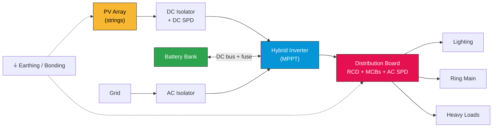
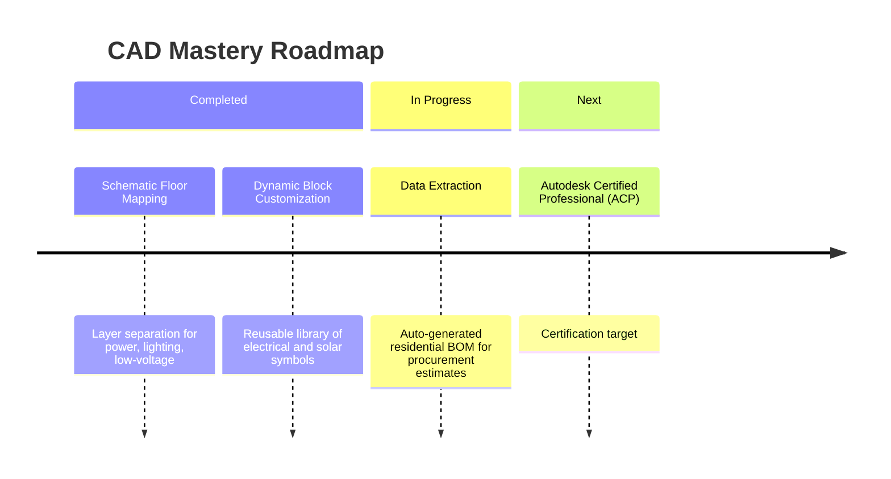

<!-- Replace every YOUR_USERNAME below with your GitHub username -->

 

---

## About Me

I design **safe, optimized, and sustainable electrical systems** for residential buildings and off-grid / grid-tied solar PV installations. I'm aligning my practical field expertise with corporate design standards through the **Autodesk Certified Professional (ACP)** track.

>  *Field-tested installs, drawn to standard.*

---

## Core Competencies

<table width="100%">
<tr>
<td width="50%" valign="top">

### Domestic Wiring & Distribution
- **Residential Layouts:** lighting matrices, ring mains, consumer unit schedules
- **Safety Architecture:** load balancing, earthing/grounding, RCD/MCB sizing
- **Regulatory Blueprints:** schematic floor plans compliant with local wiring codes

</td>
<td width="50%" valign="top">

### Solar PV System Design
- **Array Topologies:** string layouts, inverter sizing, battery bank configs
- **SLDs:** explicit DC-to-AC paths, SPD, isolation points
- **Load Analysis:** daily household consumption profiles → scalable solar footprints

</td>
</tr>
</table>

---

##  How I Draw a Hybrid Solar System

A simplified view of the power path I document in my Single Line Diagrams:

---

## Design Portfolio

| Project | Application | Core Deliverables |
| :--- | :--- | :--- |
|  [**Residential-Electrical-Blueprints**](https://github.com/YOUR_USERNAME/Residential-Electrical-Blueprints) | Complete multi-story domestic installation drawing sets | `Floor plans` `Load schedules` `Riser diagrams` |
|  [**Solar-PV-System-Schematics**](https://github.com/YOUR_USERNAME/Solar-PV-System-Schematics) | Off-grid & hybrid residential solar designs | `SLDs` `Battery string maps` |
|  [**AutoCAD-Professional-Prep**](https://github.com/YOUR_USERNAME/AutoCAD-Professional-Prep) | Drafting & scaling exercises for the Autodesk ACP exam | `Blocks` `Layout scales` `Layer management` |

---

## Professional Development

- [x] **Schematic Floor Mapping:** layer separation for power, lighting, and low-voltage distribution
- [x] **Dynamic Block Customization:** reusable, scalable library of electrical and solar symbols
- [ ] **Data Extraction:** auto-generating a residential Bill of Materials (BOM)
- [ ] **Autodesk Certified Professional (ACP)** — *Target: UPDATE_THIS_DATE*

---

## Engineering Toolkit

| Category | Tools & Outputs |
| :--- | :--- |
| **CAD Engine** |   |
| **Design Formats** | `Single Line Diagrams` · `Schematic Floor Plans` · `Plan Views` |
| **Documentation** | `Load Distribution Schedules` · `Site-Specific BOMs` |

---

## GitHub Stats

---

## Let's Connect

 

*“Powering homes efficiently, sustainably, and safely.”*

